<div align="center">


# MIZANORA

**Shop Smart. Shop Halal.** Pakistan ka online store — cash on delivery, WhatsApp support,
Quran & Hadith live channel, reels aur free tools.



<a href="https://mizanora.vercel.app"></a>
<a href="https://mizanora.vercel.app/live-channel"></a>
<a href="https://mizanora.vercel.app/api/github"></a>






<a href="https://github.com/muaaziqbalvip/MIZANORA/stargazers"></a>
<a href="https://github.com/muaaziqbalvip/MIZANORA/forks"></a>
<a href="https://github.com/muaaziqbalvip/MIZANORA/issues"></a>
<a href="https://github.com/muaaziqbalvip/MIZANORA/pulls"></a>
<a href="https://github.com/muaaziqbalvip/MIZANORA/commits/main"></a>
<a href="https://github.com/muaaziqbalvip/MIZANORA"></a>
<br>
<a href="https://nextjs.org"></a>
<a href="https://tailwindcss.com"></a>
<a href="https://firebase.google.com"></a>
<a href="https://mizanora.vercel.app"></a>
<a href="README-ADS.md"></a>

</div>

---

Next.js 15 (App Router) + Tailwind + Firebase + Meta Pixel/CAPI + installable PWA. See [SETUP.md](SETUP.md).
Checks without installing: `node scripts/check.js` (syntax and imports).

**Live:** <https://mizanora.vercel.app> · **Live channel:** <https://mizanora.vercel.app/live-channel> ·
**GitHub feed:** <https://mizanora.vercel.app/api/github> · **Ads embed:** [README-ADS.md](README-ADS.md)

---

## Animated README — poori guide (jo bhi research hui, sab yahan hai)

Yeh README khud ek live animation hai. Sab kuch **is repo ke andar** rakha hua hai
(`public/brand/readme/*.svg`) — koi third-party service nahi, kuch 404 nahi hota, rate limit nahi,
aur animation kabhi rukti nahi.


### 1. GitHub README mein animation chalti kaise hai?

| Cheez | GitHub karta kya hai |
| --- | --- |
| `<script>` | **Hata deta hai** — README mein JavaScript nahi chalti. |
| `<style>` / inline CSS | **Strip** ho jati hai (GitHub apni CSS lagata hai). |
| `` | **Chalti hai** — GitHub SVG ko `` ki tarah render karta hai. |
| SVG ke andar **CSS `@keyframes`** | **Chalte hain** ✅ |
| SVG ke andar **SMIL `<animate>` / `<animateTransform>`** | **Chalte hain** ✅ |
| GIF / APNG / WebP (animated) | Chalte hain ✅ (file bhaari hoti hai) |
| `<svg>` inline README mein | Sanitize ho jata hai — animation zyada tar mar jati hai. |

> **Asal formula:** saari harkat **SVG file ke andar** daalo, aur README mein sirf
> `` lagao. Yahi wajah hai ke hamara hero, logo, live bar, wave aur tape sab
> alag `.svg` files hain.

### 2. Is repo ki files (sab self-hosted)

| File | Kya karti hai |
| --- | --- |
| `public/brand/readme/hero.svg` | 1200×430 banner: ghoomta hua logo (crescent + star, do rings), **MIZANORA** wordmark, typing line, LIVE badge jo dhadakta hai, live screen (scan line + 22-bar waveform + progress), neeche scrolling tape. |
| `public/brand/readme/logo.svg` | Sirf logo: emerald tile, gold crescent, 8-point star, ghoomti dotted rings, twinkling stars. |
| `public/brand/readme/live.svg` | “NOW PLAYING” bar: pulsing LIVE dot + ring, teen titles jo baari baari aate hain (Quran → Hadees → product ad), chalti progress bar, PKT clock, neeche mini tape. |
| `public/brand/readme/wave.svg` | 58-bar live audio waveform, har bar ki apni speed aur delay (bilkul asli audio meter jaisa). |
| `public/brand/readme/marquee.svg` | Endless tape: `SHOP SMART ✦ SHOP HALAL ✦ CASH ON DELIVERY …` |

**Dobara banana ho to:**

```bash
node scripts/make-readme-art.mjs      # sab 5 SVG dobara likh deta hai
```

Script hi asli source hai — colours, text, speed badalne ke liye `scripts/make-readme-art.mjs`
ke upar wale hisse (`C` colours, `typedLine`, `mark`, `ticker` items) edit karo aur command dobara chalao.
Generated SVG files bhi repo mein commit hoti hain, is liye GitHub par turant dikhti hain.

### 3. Animation kaise likhi gayi (jo cheezein GitHub par sach much chalti hain)

```svg
<!-- 1. pulse (LIVE dot) -->
<style>
  .live-dot { animation: mz-live 1.5s ease-in-out infinite; transform-box: fill-box; transform-origin: center; }
  @keyframes mz-live { 0%,100% { opacity:1; transform:scale(1) } 50% { opacity:.45; transform:scale(.62) } }
</style>
<circle class="live-dot" cx="674" cy="85" r="4.6" fill="#fff"/>
```

```svg
<!-- 2. typing line: har harf apni opacity, monospace ki wajah se position exact -->
<text class="ch" x="180.0" y="182" style="animation-delay:0.180s">S</text>
<text class="ch" x="188.4" y="182" style="animation-delay:0.240s">h</text>
<style>
  .ch { opacity:0; animation: mz-ch 7s linear infinite both; }
  @keyframes mz-ch { 0%{opacity:0} 1.6%{opacity:1} 92%{opacity:1} 97%{opacity:0} 100%{opacity:0} }
</style>
```

```svg
<!-- 3. endless tape: do barabar lines, group poore ek line ke barabar khisakta hai -->
<style>@keyframes tape { from { transform: translateX(0) } to { transform: translateX(-1840px) } }</style>
<g class="tape" style="animation: tape 30s linear infinite">
  <text x="0"    y="390">SHOP SMART ✦ SHOP HALAL ✦ …</text>
  <text x="1840" y="390">SHOP SMART ✦ SHOP HALAL ✦ …</text>
</g>
```

```svg
<!-- 4. waveform: ek hi keyframe, har bar ka apna delay -->
<rect class="bar" x="292" y="40" width="6" height="42" rx="3"
      style="animation-delay:0.045s; animation-duration:1.02s"/>
<style>
  .bar { transform-box: fill-box; transform-origin: 50% 100%; animation: bar 1.15s ease-in-out infinite; }
  @keyframes bar { 0%,100% { transform: scaleY(.22) } 50% { transform: scaleY(1) } }
</style>
```

Teen zaroori baatein jo humne seekhin:

1. **`transform-box: fill-box`** — SVG shapes rotate/scale apne center se karein, warna sab `(0,0)` se ghoomta hai.
2. **`animation-fill-mode: both`** — jo cheez `animation-delay` ke saath aati hai, wo apne time se pehle **chhupi** rahe (warna saare titles ek saath dikhte hain).
3. **Monospace/text-anchor** — GitHub koi font download nahi karta, is liye text ki width par bharosa mat karo: pill ka background text se **hisab** se banao (ya `text-anchor="middle"` use karo).

### 4. Reduced motion (zaroori)

Har file ke `<style>` ke aakhir mein:

```css
@media (prefers-reduced-motion: reduce) {
  .ch,.caret,.spin-slow,.spin-rev,.glow,.twinkle,.live-dot,.ring,.bar,.aurora,.sheen,.scan,.fill,.fade1,.fade2,.fade3,.pulse-soft,.tape { animation: none !important; }
  .ch,.fade1,.fade2,.fade3 { opacity: 1 }
}
```

Jo visitor phone/OS mein “reduce motion” on karta hai, usay animation ki jagah **poora static banner** milta hai.
Yeh sirf adab nahi, accessibility ka requirement hai.

### 5. Dusre tareeqe jo duniya use karti hai (aur kab use karna chahiye)

| Technique | Kaise | Faida | Nuqsan |
| --- | --- | --- | --- |
| **Self-hosted animated SVG** (yehi humne kiya) | SVG file repo mein, README mein `` | kabhi 404 nahi, rate limit nahi, poora control | animation SVG ke andar hi rehti hai |
| **`readme-typing-svg`** | `https://readme-typing-svg.demolab.com?lines=Hi;Hello` | typing effect 1 line mein | third-party, teesri site down ho to image gayab |
| **`capsule-render`** | `https://capsule-render.vercel.app/api?type=waving&text=MIZANORA` | khoobsurat header banner | wahi third-party risk |
| **`github-readme-stats`** | `https://github-readme-stats.vercel.app/api?username=...` | live stats card | service kabhi slow/limit ho jati hai |
| **Snake game** | `Platane/snk` Action → `snake.svg` commit | contribution graph “khata” hai | roz Action chalana padta hai |
| **GitHub Action se roz generate** | cron → Python/Node script → SVG commit | asli data (contributions, stats) roz update | Action minutes kharch |
| **GIF / APNG** | screen record → GIF | har jagah chalta hai | file bhaari, quality kam, retina blur |

Humne **self-hosted SVG** chuna kyunki yeh shop ka repo hai: koi bhi link kabhi tootna nahi chahiye.
Agar aapko **profile** README (github.com/aapka-naam) banana ho to teesri-party services tab bhi
theek hain — ek ready template yahan hai: **[docs/PROFILE-README.md](docs/PROFILE-README.md)**.
Poori research aur tools ki list **[docs/README-ANIMATION.md](docs/README-ANIMATION.md)** mein hai.

### 6. GitHub par animation na dikhe to?

- **5 minute intezaar karo** — GitHub images ko cache karta hai. Turant badalna ho to README mein
  `hero.svg?v=2` likho aur har update par number barhao.
- **Preview app mein nahi chalti** — Windows Photos / macOS Preview / kuch editor SVG animation
  nahi chalate. Browser (ya GitHub) mein kholo.
- **Path sahi hai?** — README se relative path: `public/brand/readme/hero.svg`. Har file ka naam
  chhota rakho, spaces na rakho.
- **`raw.githubusercontent.com`** par file khul rahi hai? Nahi? To commit/push nahi hua.
- **Image dikh rahi hai magar still hai?** — us `` ke andar wali file mein `<style>` block
  hai ya nahi check karo; GitHub `` mein SVG ki CSS aur SMIL dono chalata hai, magar `<script>`
  nahi.

---

## Background music (Admin > Music)
- **Admin > Music** has two cards: **App background music** (plays across the whole shop) and **Reels background music** (plays behind the reels that have no sound of their own).
- The admin only pastes a **direct audio link** (`.mp3`, `.m4a`, `.ogg`, `.wav`). Google Drive and Dropbox share links are converted automatically. Cloudinary (free) is the easiest host.
- The shopper gets a **music button in the header** to switch it off; the choice is remembered on their device (`mz_app_music`).
- Browsers never play sound before the first tap, so the music starts after the first touch. While a full-screen reel is open the background music steps aside (the reel has its own music).
- Stored in Firestore: `siteMeta/appMusic` and `siteMeta/reelMusic` (read by everyone, written only by the admin). Optional fallback: `NEXT_PUBLIC_APP_MUSIC_URL` / `NEXT_PUBLIC_REEL_MUSIC_URL`.

## Search
- The header search understands English, Roman Urdu and Urdu words, colours, price limits ("under 2k"),
  "sasta / premium", and forgives spelling mistakes (`lib/search.js`).
- **Keyboard:** `↑`/`↓` move through the suggestions, `Enter` opens the highlighted one, `Esc` closes the panel.
- The typed words are **highlighted** in the product names, a matching **category** is offered as its own row,
  and the panel scrolls on small screens.
- A colour that you type really filters: "black joota" no longer brings the blue shoes along.
- The results page shows `12 products for "laal suit"`, and when nothing is found it suggests the other
  shelves and the AI assistant.

## Firestore reads (quota saver)
Products/banners/reels are read from Firestore ONCE and shared by all pages through Next's data cache (tag `catalog`, see `lib/products.js`).

## Promo codes (Admin > Promo codes)
- Create a code with a `%` off or a flat Rupee amount, a minimum cart value and an optional expiry.
- A shopper types it in the cart; the discount is checked again on the server before the order is saved.
- Stackable rules live in `lib/promo.js`; the code is stored with the order so the invoice always shows it.

## Optional: free delivery above an amount
Set `NEXT_PUBLIC_FREE_SHIPPING_OVER=5000` and delivery becomes free from Rs 5,000. `0` = off.

## Season + Islamic theme
Hebrew-free, purely Islamic seasonal dressing (Ramadan, Eid, winter, monsoon) driven by the day of the year,
with lanterns, stars, leaves and a soft geometric background. Colours come from `lib/theme.js` and are safe for
contrast. The admin can pin a season from **Admin > Theme**.

## Smooth and light
Every animation is CSS-only and honours `prefers-reduced-motion`. Images use the 3-step chain
(`RemoteImg` → `/api/img` relay → hide), so a dead photo never shows a broken icon.

## Categories and filters
`/products` and `/category/<slug>` share one filter bar (`price`, `colour`, `sale`, `sort`). The URL is the
state, so every combination is shareable and every page is static.

## Checks before deploying
```bash
npm ci
npm run check      # scripts/check.js  +  scripts/typecheck.js
npm test           # 24 test files, including v33 live badges + GitHub
npm run build:offline
```
Both feeds are paged (each part stays under ~4 MB):
`/api/feed?part=N`, `/api/feed/google?part=N`, `/catalog.json?part=N`.

## v38 upgrade (100,000 Live TV channels, bulk import, editing tools)

- **Live TV holds 100,000 channels now** (it stopped at 800). A Firestore document may hold
  1 MB, so the channel list is no longer stored inside the setting: it is **sharded** across
  `siteMeta/liveTv/channels/p0, p1, …`, packed by size as well as by count. Measured: 100,000
  channels → 80 shards, largest 306 KB, packed in 247 ms. Old installs read as-is; the next
  Save rewrites them into shards.
- **Xtream Codes can fill the shop by itself.** New **"Straight into the shop"** button: the
  server pulls the panel, merges (Add *or* Replace), writes the shards and revalidates `/live`
  — only the counts travel back, so a 100,000-channel panel takes seconds instead of freezing
  the tab. The importer fetches **category by category** (four at a time) rather than one 30 MB
  download. Limits: 100,000 channels, 48 MB bulk / 12 MB per category, 60 s timeout.
- **Delete every channel at once** — from the bulk tools (then Save), or straight from the
  database with "Delete all channels from the database". Plus delete ticked / search results /
  a whole group / every dead channel.
- **A full set of editing tools** in Admin → Live TV: find & replace across names, links, logos
  and groups; prefix/suffix; capitalise; tidy spaces; rename a group; switch a group on or off;
  remove duplicate links and names; clear all logos; sort; reverse. Every tool works on a scope
  you pick — **ticked / search results / all** — and none of them save behind your back.
- **The channel list is paged** (50 at a time) with tick-page and select-all-found, because
  100,000 rows would freeze the tab.
- **The dashboard's missing charts:** most-read pages, new vs returning, busiest hours, busiest
  weekdays, and a totals strip. Range now up to **90 days**.
  The **by-hour chart had never worked** — it read a field nothing ever wrote. `lib/track.js`
  writes `stats/hr/<day>/<HH>` now and the chart reads that.
- **Fixes:** `lib/seo.js` was emitting relative `canonical` / `og:url` / `og:image` (Google
  needs absolute); `scripts/check.js` now fails on any internal `/blog/<slug>` link that points
  at a post that does not exist; the sitemap's TV cap went from 800 to 8,000 channels.

### v38.1 — the fonts are self-hosted (the Vercel build was failing)

`next/font/google` downloads the font files **while the app builds**, so the build dies as soon as
the build machine cannot reach `fonts.googleapis.com` — which is what happened on Vercel
(`TypeError: Cannot read properties of null (reading '1')` from the Google font loader). All nine
woff2 files (Plus Jakarta Sans, Inter, Amiri — 344 KB) now live in `public/fonts/` and are loaded
with `next/font/local`, so **the build needs no network at all** and the shop serves the fonts
from its own domain. The CSS variables are unchanged, so no styling moved.

Worth knowing: `npm run build:offline` mocks the Google response, which is why this never showed
up locally — **the real `npm run build` is the gate that matters**, and it passes now.

Full notes: [UPGRADE-v38.md](UPGRADE-v38.md).

## v37 upgrade (Live TV by login, open analytics, and a news desk)

- **Live TV connects with a username and password.** Admin → Live TV now takes an **Xtream
  Codes** panel: server, username, password, **Test connection**, pick the groups you want,
  import live TV / movies / series. The call is admin-only, refuses private and loopback
  addresses, follows no redirects, caps the body at 8 MB, and never stores or logs the
  password. Free credentials to try it: [BarakatWave TV](https://barakatwave.vercel.app) →
  *Generate My Free Xtream Server*. Walkthrough:
  [the setup guide](/blog/barakatwave-tv-xtream-codes-setup-guide).
- **Analytics got deeper, and part of it went public.** The dashboard now keeps up to **90
  days** and reports most-read pages, new vs returning visitors, traffic by hour and by
  weekday, and all-time totals. New **`/stats`** is open to anyone — no sign-in — with a live
  "on the site now" count, a 14-day sparkline, top pages and the device/source split,
  refreshing every minute. `/api/stats` returns **totals only**: no visitor ids, no presence
  records, no order or cart contents, no search words.
- **A news desk at `/news`.** World, science and technology, written as dated articles so
  every dispatch indexes on its own, with tabs, a lead story and its own **RSS feed** at
  `/news/feed.xml`. Three new shelves in `lib/blog.js` exported as `NEWS_CATEGORIES`.
- **Eleven new articles** (136 in total): three world-news pieces with a Pakistan angle
  (the 2026 economy, why delivery charges move, tariffs and import prices), two science
  pieces (the 2026 space results; what the Mars organics really mean), two technology pieces
  (AI's electricity and your next phone; buying through the chip shortage), two about
  [Muaaz Iqbal](/muaaz-iqbal) (his character, and every project mapped), and two supporting
  **BarakatWave TV** and **SIRAVEX**.
- **`/news` and `/stats` are in the sitemap**, and every dispatch carries breadcrumb and
  collection structured data.

Full notes: [UPGRADE-v37.md](UPGRADE-v37.md).

## v36 upgrade (Muaaz Iqbal is on the site + a blog built for 125 guides)

- **His pictures now live in the shop.** Eight photos were optimised into `public/img/muaaz/`
  (full, thumb and square for each), EXIF and GPS stripped, and listed in
  `data/muaaz-photos.json`. They power a real gallery with a lightbox on
  [`/muaaz-iqbal`](/../app/muaaz-iqbal/page.js), the avatar on `/team`, and the image sitemap —
  all served from `mizanora.vercel.app`, so no third-party host can break or block them.
  Re-run any time: `node scripts/muaaz-photos.mjs <folder>`.
- **Twenty new guides:** eight on how Muaaz Iqbal thinks (the Mizan mindset, zero-quota,
  Urdu-first, small steps, compounding, trust-first, the AI orchestra, plus a Roman-Urdu one),
  three shopping guides, four search guides, and five grounded 2026 tech-and-commerce pieces.
  The blog is now **125 guides**.
- **Six new topic hubs** at `/blog/category/<slug>` with `CollectionPage` data, and a `/blog`
  that is paginated and searchable instead of rendering 125 cards at once.
- **Eleven real bugs fixed**, including a `{cta}` placeholder that never rendered in 22 guides,
  a "Keep reading" list that was just the newest two posts, local images being impossible in
  markdown, and two sitemap bugs (`//img/...` and relative image URLs) that Google rejects.
- **Google submission pack:** `node scripts/search-console.mjs` writes 141 pages in 15 daily
  batches of 10 (Google's URL Inspection limit) plus the image list and a step-by-step
  `README.txt`. Search Console itself still needs a signed-in human — there is no way around that.

Full notes: [UPGRADE-v36.md](UPGRADE-v36.md).

## v35 upgrade (a pro-level GitHub profile, generated from this repo)

The owner's profile README (github.com/muaaziqbalvip) is now generated here and shipped as a ready
package in [`profile/`](profile/SETUP.md):

- **18 animated SVGs**, each in a dark **and** a light file (`<picture>` + `prefers-color-scheme`):
  `hero` (rotating monogram, sweeping name, typing line, rotating "currently" line, chips, live card
  with LIVE dot + 3 rotating titles + 20-bar waveform + progress + real counts), `ticker`, `live`
  (LIVE strip with latest push), `stats` (6 number cards), `languages` (share-of-repos bar),
  `logo`, `projects` (6 cards), `tech-stack` (4 shelves) and `philosophy`.
- **The numbers stay true:** every changing value is tagged `data-k="..."`;
  `profile/scripts/refresh-live.mjs` reads the public GitHub API and the shop's `/api/github` and
  rewrites only that text. A run with the same numbers changes nothing.
- **`profile/.github/workflows/refresh.yml`** does it nightly (02:17 UTC), regenerates the art first,
  and commits only when something actually changed.
- **The generator** is `scripts/make-profile-art.mjs` (in this repo; `profile/scripts/make-art.mjs` is
  the same file). The same art is served by the shop at `/brand/profile/*.svg`.
- Setup, files and the nightly job: [`profile/SETUP.md`](profile/SETUP.md). Tests:
  `node scripts/test-v35.mjs` (10 checks).

## v33 upgrade (pure-live badges + GitHub on the website)

- **One live badge everywhere.** `components/LiveBadge.js` + `lib/liveBadges.js` draw every `LIVE / SOON / NEW / OFF AIR` label on the shop: a red dot that beats, a slow sheen, amber for "starts soon", green for new. All CSS, all switched off for `prefers-reduced-motion`.
- **The live bar** (`components/LiveStrip.js`) sits under the hero on the home page and on `/live`: pulsing badge, what is playing now (tilawat / hadees / product ad) with a real progress bar, minutes left and "phir ..." (what is next), the Pakistan clock ticking every second, the live TV channel count and the channel's own ticker in a marquee. The program comes from the same wall clock as `/live-channel`, so it is never a made-up number.
- **Reels look live:** cards carry `TRENDING` (first card), `NEW` (fresh) and a real `-20% OFF` badge (only when `comparePrice > price`); the full-screen viewer shows `PLAYING / PAUSED`.
- **Live TV:** a pulsing `LIVE / CONNECTING / RETRY` ribbon on the picture, `ON AIR` + group badges on `/live/<channel>`, and the clock is no longer hidden on phones.
- **GitHub is part of the site now.**
  - `GET /api/github` - the public profile, repositories, stars, languages and last push, cached 30 minutes (`X-GitHub-Live`, `?bare=1` for a tiny badge request).
  - `<GitHubLive />` on `/muaaz-iqbal` (8 repos) and `/team` (4 repos): avatar, followers, stars, forks, language bar, NEW / ACTIVE / MIT / LIVE DEMO badges and "2 ghante pehle" notes.
  - `GitHub` is in `SITE.social` (footer icon + `/connect`), and `POST /api/revalidate` accepts tag `github` to refresh instantly.
  - Optional env: `GITHUB_USER`, `GITHUB_PINNED` (comma separated, the repos shown first), `GITHUB_CACHE_SECONDS`, `NEXT_PUBLIC_GITHUB_URL`.
  - If GitHub is unreachable the section renders from `FALLBACK_REPOS`, so the page is never empty.
- Tests: `node scripts/test-v33.mjs` (badges, clock, live bar, reel badges, GitHub model, hydration safety).

## v32 upgrade (photos + video ads + big catalogue)

- **Photos that always load:** every picture goes through `RemoteImg` → `/api/img` relay → hidden. A dead
  link never shows a broken icon, and the relay refuses private hosts and non-images.
- **Video ads that really play:** mp4 / webm / HLS (via `/api/ads/hls.js`), plus YouTube, Facebook, Instagram,
  TikTok, Vimeo, Dailymotion and Drive. Play / pause / mute / skip work, and the slot waits for the video
  before it rotates. See [README-ADS.md](README-ADS.md) and [UPGRADE-v32.md](UPGRADE-v32.md).
- **Feeds that fit the platform:** `/api/feed`, `/api/feed/google` and `/catalog.json` are split into
  `?part=N` pieces under the 4.5 MB serverless limit, with `X-Feed-Pages` and `Link` headers.

## v30 upgrade

See [UPGRADE-v30.md](UPGRADE-v30.md): Live TV themes, quality and audio menus, favourites, auto-skip and
shareable `/live/<channel>` pages.

---

<div align="center">


**MIZANORA** · Kasur, Punjab, Pakistan · cash on delivery across Pakistan
<br>
<a href="https://mizanora.vercel.app">Website</a> ·
<a href="https://mizanora.vercel.app/live-channel">Live channel</a> ·
<a href="https://mizanora.vercel.app/muaaz-iqbal">Founder</a> ·
<a href="https://github.com/muaaziqbalvip">GitHub</a>

</div>
