# Profile repo — setup (github.com/muaaziqbalvip)

Yeh folder aapke **profile repository** (`muaaziqbalvip/muaaziqbalvip`) ka poora content hai:
upgraded README + 12 animated SVG (dark + light) + generator + daily refresh workflow.

## Ek dafa ka kaam (5 minute)

```bash
# 1. profile repo clone karo (na ho to banao)
gh repo clone muaaziqbalvip/muaaziqbalvip 2>/dev/null || gh repo create muaaziqbalvip --public --add-readme --clone
cd muaaziqbalvip

# 2. yeh folder yahan copy karo (MIZANORA repo se)
cp -r /path/to/MIZANORA/profile/. .

# 3. commit + push
git add -A && git commit -m "profile: animated art + live numbers" && git push
```

Phir GitHub par: **Settings → Actions → General → Workflow permissions → Read and write**
(warna nightly workflow commit nahi kar sakega).

Bas. Roz 02:17 UTC par `refresh live numbers` chalta hai aur numbers khud update karta hai
(repos, stars, followers, latest push, top language, "Last refreshed").

## Kya kya hai

| Path | Kya hai |
| --- | --- |
| `README.md` | Profile ka README: hero → ticker → badges → live strip → stats → **photos** → projects → stack → how I work → contact → "how this stays alive" |
| `assets/hero.svg` · `hero-light.svg` | 1200×420 banner: ghoomta monogram, naam ka sheen, typing line, rotating "currently" line, chips, aur live card (LIVE dot, 3 titles, 20-bar waveform, progress, 92 repos · 12 stars · 6 followers) |
| `assets/ticker.svg` · `ticker-light.svg` | Endless tape: MIZANORA · ASAAN LANG · BARAKATWAVE TV · SIRAVEX … |
| `assets/live.svg` · `live-light.svg` | "LIVE right now" strip: LIVE chip, rotating titles, waveform, LATEST PUSH + numbers |
| `assets/stats.svg` · `stats-light.svg` | 6 number cards (repos, stars, products, channels, tools, projects) |
| `assets/languages.svg` · `languages-light.svg` | Language share bar + legend (share of repositories, not bytes) |
| `assets/logo.svg` · `logo-light.svg` | Mark on its own (favicon-ish, footer) |
| `scripts/make-art.mjs` | **Source of all art.** Colours/text/speed yahan badlo, phir: `node scripts/make-art.mjs` |
| `scripts/refresh-live.mjs` | GitHub + shop `/api/github` se asli numbers, `data-k="…"` tags mein patch |
| `.github/workflows/refresh.yml` | Roz 02:17 UTC: art regenerate → numbers refresh → commit (sirf badla ho to) |
| `assets/photos/*.jpg` | **Muaaz ki 8 tasweerein** (512×512, EXIF/GPS hata diya gaya). README mein "📸 Photos" grid unhi ko dikhata hai. |

> Purane art files (`projects.svg`, `tech-stack.svg`, `philosophy.svg`, `stats.svg` ka purana version)
> README ab bhi use karta hai — unhe **mat delete karo** jab tak naya art unki jagah na le le.
> Naye files ke naam alag hain, is liye kuch tootega nahi.

## Numbers sach mein live kaise hote hain

SVG ke andar har number aisa likha hai:

```svg
<tspan font-size="17" font-weight="800" fill="#64E7B0" data-k="repos">92</tspan>
```

`refresh-live.mjs` sirf `data-k="repos"` wale tags ka **text** badalta hai — animation, colours,
layout bilkul waisa hi rehta hai. Isi tarah `README.md` mein:

```html
<sub>Last refreshed · <span data-k="updated">October 2026</span> · built by hand, tested on a cheap phone</sub>
```

Naye keys add karna ho to `scripts/refresh-live.mjs` ke `KEYS` array mein naam daal do aur
`collect()` mein value set kar do.

## Local test

```bash
node scripts/make-art.mjs          # art dobara likho (defaults ke sath)
node scripts/refresh-live.mjs      # asli GitHub numbers se patch (network chahiye)
```

`refresh-live.mjs` network na mile to **kuch nahi likhta** aur exit 1 deta hai — git tree saaf rehta hai.

## Dark / light

README har picture ke liye do files deta hai:

```html
<picture>
  <source media="(prefers-color-scheme: dark)" srcset="./assets/hero.svg" />
  <source media="(prefers-color-scheme: light)" srcset="./assets/hero-light.svg" />
  
</picture>
```

Is liye dono themes mein text readable rehta hai (GitHub ka dark mode kaafi gehra hai).

## Reduced motion

Har SVG ke `<style>` ke aakhir mein:

```css
@media (prefers-reduced-motion: reduce){
  .spin-slow,.glow,.live-dot,.ring,.bar,.tape,.ch,.caret,.fade1,.fade2,.fade3,.pop,.fill,.scan{animation:none!important}
  .ch,.fade1,.pop{opacity:1}
}
```

Jo visitor motion band karta hai usay **poora static banner** milta hai, khaali frame nahi.
